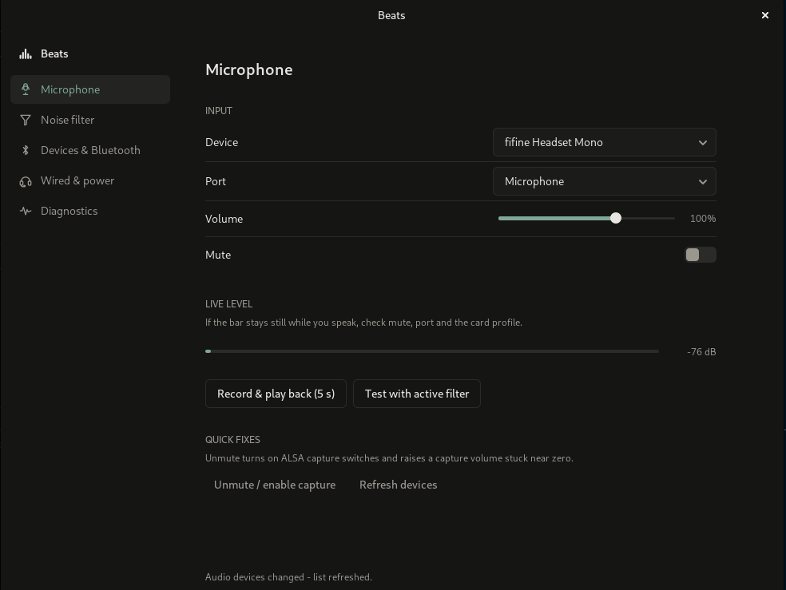

  

# Beats

Beats is a small GTK app for Debian (PipeWire + WirePlumber) that makes a
headset or earbud microphone usable. It lives in your applications menu,
opens as a normal window, and does not ask you to install extra plugins
before the interesting parts work.

  

## What it is for

On Linux, a headset mic fails in boring, specific ways:

- The machine is listening to the laptop's built-in mic, or to a port
  with nothing plugged in.
- Bluetooth headphones drop into call mode (HFP/HSP). Music still sounds
  fine; your voice does not. Eight kilohertz, muddy, and noisy.
- Capture is muted at the ALSA layer, or hardware Mic Boost is cranked so
  high that the recording is mostly hiss.
- The card is on an output-only profile, so the mic does not exist as far
  as the desktop is concerned.

You can chase all of that through `pactl`, WirePlumber config snippets,
and a restart of PipeWire. Beats puts the same controls in one window: pick
the device and port, watch a live level, record five seconds and hear it
back, drop in a noise filter, switch the Bluetooth profile, and turn off
the Intel HDA power-save click.

The Strong filter is WebRTC (already on Debian). Maximum is RNNoise; the
plugin is bundled and set up when the package is installed. If a filter
fails to load, Beats removes it and puts your audio back the way it was.

The buttons at the bottom of the sidebar switch between light, dark, and
following the desktop's theme; the choice is remembered. The button next to
close in the title bar toggles fullscreen (also F11; Esc leaves it), and the
title bar stays up while fullscreen.

## Install (as a user)

Install the `.deb` from the
[releases page](https://github.com/Tomax47/Beats/releases). That file is
the app; cloning this repository is for development, further down.

The published package is **amd64** (64-bit Intel and AMD). arm64 and i386
are not in the release.

1. Open the [latest release](https://github.com/Tomax47/Beats/releases/latest)
   and download `beats_<version>_amd64.deb`. For 1.4.0 that file is
   `beats_1.4.0_amd64.deb`.
2. In the folder that contains the download:

       sudo apt install ./beats_1.4.0_amd64.deb

   Apt pulls in GTK, PipeWire, and the rest. You should not have to
   `apt install` anything else for Beats itself to open.

3. Open **Beats** from the applications list (GNOME, KDE, XFCE, Cinnamon,
   MATE, LXQt, …), or run `beats` in a terminal.

That install is system-wide: `/usr/bin/beats`, a desktop entry, and an
icon. After install, Maximum mode is already linked into `/usr/lib/ladspa`.

To undo what Beats wrote on disk:

- `~/.config/wireplumber/wireplumber.conf.d/51-headset-mic-fixer.conf`
- `~/.config/pipewire/pipewire.conf.d/51-headset-mic-fixer.conf`
- `/etc/modprobe.d/headset-mic-fixer.conf` (power-save; written with pkexec)
- `~/.config/beats/settings.json` (theme choice)

Then: `systemctl --user restart pipewire pipewire-pulse wireplumber`

Remove the app with `sudo apt remove beats`.

## Fork and run in development

Fork [Tomax47/Beats](https://github.com/Tomax47/Beats), then clone your
fork and work in that tree:

    git clone git@github.com:YOUR_USER/Beats.git
    cd Beats

Install the libraries the window needs, then start it from this checkout:

    sudo apt install python3-gi python3-gi-cairo python3-cairo gir1.2-gtk-3.0 \
        pipewire-bin pulseaudio-utils alsa-utils
    ./run.sh

`./run.sh` runs `src/headset_mic_fixer.py` with the system Python, from
this checkout. The applications-menu entry comes from the package:
`./build-deb.sh`, then `sudo apt install ./dist/beats_<version>_amd64.deb`.

Regenerate the launcher SVG after touching the mark:

    python3 tools/gen_logo.py

Push the branch to your fork and open a pull request against
[Tomax47/Beats](https://github.com/Tomax47/Beats). What is worth sending is
under Contributing.

## Layout

- `src/headset_mic_fixer.py` — the window
- `src/beats_theme.py` — design tokens and the GTK stylesheet built from them
- `src/beats_logo.py` — vector mark (bars + SVG)
- `tools/gen_logo.py` — writes the launcher SVG
- `packaging/` — Debian skeleton
- `vendor/librnnoise_ladspa.so` — RNNoise, shipped with the package
- `build-deb.sh` — writes `dist/beats_<version>_amd64.deb`

## Contributing

This is an MIT-licensed project. Issues, patches, and stubborn hardware
reports are welcome.

If you want to send a change: keep it in the same neighbourhood as the
existing code (one Python file for the UI, packaging under `packaging/`,
no extra framework). A useful report is a Diagnostics page dump plus
what headset you plugged in and whether it is Bluetooth or wired.

I care most about:

- headsets that still show up silent after the obvious port/profile fix
- filters that fail on a particular PipeWire version
- desktop environments where the Beats icon does not launch the window

Break it on your machine, then send back what you learned. The fork and
`./run.sh` steps are in Fork and run in development.

## License

Beats (the Python app, packaging, and mark) is MIT. See `LICENSE`.

The RNNoise binary under `vendor/` comes from
[noise-suppression-for-voice](https://github.com/werman/noise-suppression-for-voice)
and is GPL-3.0. That file keeps its own license; it is not re-licensed as
MIT just because we ship it next to Beats.
